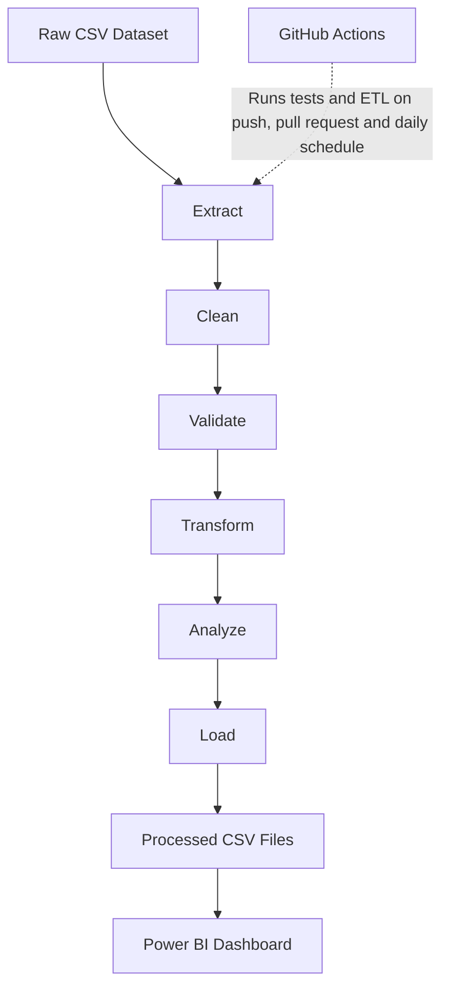

# Student Performance Analytics & Automated ETL Pipeline

[](https://github.com/vishal-kushwaha-9912/student-performance-analytics/actions/workflows/etl-pipeline.yml)


An end-to-end data analytics project that turns messy student performance data into clean, validated, analysis-ready datasets using **Python and Pandas**, with an interactive **Power BI** dashboard for visualization.

---

## Table of Contents

- [Project Overview](#project-overview)
- [Objectives](#objectives)
- [Technologies Used](#technologies-used)
- [ETL Pipeline](#etl-pipeline)
- [ETL Pipeline Architecture](#etl-pipeline-architecture)
- [Project Structure](#project-structure)
- [Installation and Setup](#installation-and-setup)
- [Run the ETL Pipeline](#run-the-etl-pipeline)
- [Run Automated Tests](#run-automated-tests)
- [Key Analytical Findings](#key-analytical-findings)
- [Power BI Dashboard](#power-bi-dashboard)
- [Data Quality and Limitations](#data-quality-and-limitations)
- [Future Improvements](#future-improvements)
- [Contributing](#contributing)
- [License](#license)
- [Author](#author)

---

## Project Overview

This project demonstrates a complete data analytics workflow on a synthetic student performance dataset.

The pipeline extracts raw data, cleans inconsistencies, validates data quality, creates performance and attendance categories, performs statistical analysis, and exports processed datasets for visualization in Power BI.

Automated tests are written with Pytest, and GitHub Actions provides continuous integration by automatically running tests and the ETL pipeline on pushes and pull requests. A scheduled workflow also runs the pipeline daily.

## Objectives

- Clean and prepare messy, real-world-style data.
- Handle missing values and invalid records.
- Validate data quality.
- Categorize student performance and attendance.
- Analyze academic performance trends.
- Build an interactive Power BI dashboard.
- Automate testing and pipeline execution.

## Technologies Used

| Technology     | Purpose                                                 |
| -------------- | ------------------------------------------------------- |
| Python         | ETL pipeline development                                |
| Pandas         | Data cleaning and analysis                              |
| NumPy          | Numerical operations (installed as a Pandas dependency) |
| Pytest         | Automated testing                                       |
| Power BI       | Interactive dashboard                                   |
| Git            | Version control                                         |
| GitHub         | Project hosting                                         |
| GitHub Actions | Workflow automation                                     |

## ETL Pipeline

| Stage         | Module         | Description                                                                                 |
| ------------- | -------------- | ------------------------------------------------------------------------------------------- |
| **Extract**   | `extract.py`   | Read the raw student performance CSV file.                                                  |
| **Clean**     | `clean.py`     | Normalize inconsistent values, fill missing study hours, flag invalid attendance.           |
| **Validate**  | `validate.py`  | Check required columns, unique student IDs, valid marks, attendance, and study/sleep hours. |
| **Transform** | `transform.py` | Create performance and attendance categories.                                               |
| **Analyze**   | `analyze.py`   | Calculate summary statistics, performance distributions, and correlations.                  |
| **Load**      | `load.py`      | Export cleaned, transformed, and summarized CSV files.                                      |

`pipeline.py` orchestrates all stages in order.

## ETL Pipeline Architecture

The diagram below shows how data moves through the project. GitHub Actions is shown separately because it automates the tests and the ETL run. It does not build the Power BI dashboard.


## Project Structure

```text
student-performance-Analytics/
│
├── data/
│   ├── raw/
│   │   └── student_performance_messy.csv
│   └── processed/
│
├── src/
│   ├── extract.py
│   ├── clean.py
│   ├── validate.py
│   ├── transform.py
│   ├── analyze.py
│   ├── load.py
│   └── pipeline.py
│
├── tests/
│   └── test_pipeline.py
│
├── notebooks/
│   └── exploration.ipynb
│
├── powerbi/
│   └── Student_Performance_Analytics_Dashboard.pbix
│
├── reports/
├── .gitignore
├── LICENSE
├── requirements.txt
└── README.md
```

## Installation and Setup

### 1. Clone the repository

```bash
git clone YOUR_GITHUB_REPOSITORY_URL
cd student-performance-Analytics
```

### 2. Create a virtual environment

```bash
python -m venv .venv
```

### 3. Activate the virtual environment

**Windows (PowerShell):**

```powershell
.\.venv\Scripts\Activate.ps1
```

**macOS / Linux:**

```bash
source .venv/bin/activate
```

### 4. Install dependencies

```bash
python -m pip install -r requirements.txt
```

## Run the ETL Pipeline

From the project root directory:

```bash
python -m src.pipeline
```

The pipeline extracts, cleans, validates, transforms, analyzes, and exports the datasets. Outputs are written to:

```text
data/processed/
```

## Run Automated Tests

```bash
python -m pytest -v
```

The project currently contains **nine** automated tests covering:

- Data extraction
- Data cleaning
- Data transformation
- Data analysis
- Data loading
- Data validation
- Duplicate student ID detection
- Invalid marks detection
- Negative study hours detection

**Latest local test result:** 9 passed.

## Key Analytical Findings

Results from the 10-row synthetic dataset:

| Metric              | Result |
| ------------------- | -----: |
| Total students      |     10 |
| Average marks       |  78.50 |
| Average study hours |   2.78 |
| Average attendance  | 85.78% |
| Highest marks       |     96 |
| Lowest marks        |     48 |

### Correlation Findings

| Variables             | Correlation |
| --------------------- | ----------: |
| Study hours and marks |        0.67 |
| Attendance and marks  |        0.94 |
| Sleep hours and marks |        0.45 |

> **Note:** These are descriptive results from a very small synthetic dataset. Correlation does not establish causation, and the results should not be generalized to real student populations.

## Power BI Dashboard

The dashboard (`powerbi/Student_Performance_Analytics_Dashboard.pbix`) presents:

- Total students
- Average marks
- Average attendance
- Performance distribution
- Average marks by performance category
- Individual student marks
- Study hours versus marks
- Attendance versus marks
- Student performance details
- Performance and attendance filters

To open it, install [Power BI Desktop](https://powerbi.microsoft.com/desktop/), run the pipeline, and refresh the data source so it points to your local `data/processed/` folder.

## Data Quality and Limitations

- The dataset is synthetic and created for learning and portfolio demonstration.
- An invalid attendance value above 100% is treated as missing rather than silently corrected.
- Missing study hours are filled using the median.
- The dataset contains only 10 student records, so findings are illustrative.
- Processed datasets, notebook outputs, and generated reports are excluded from version control by default.

## Future Improvements

- [ ] Implement GitHub Actions for automated testing and ETL execution.
- [ ] Add larger and more varied datasets.
- [ ] Expand data quality checks.
- [ ] Add automated reporting.
- [ ] Improve dashboard insights and visualizations.

## Contributing

Contributions, issues, and suggestions are welcome.

1. Fork the repository.
2. Create a feature branch: `git checkout -b feature/your-feature`
3. Commit your changes: `git commit -m "Add your feature"`
4. Make sure tests pass: `python -m pytest -v`
5. Push the branch and open a Pull Request.

## License

This project is licensed under the **MIT License**. See the [LICENSE](LICENSE) file for details.

## Author

**VISHAL KUSHWAHA**

---

**Project:** Student Performance Analytics & Automated ETL Pipeline
**Purpose:** Data Analytics Portfolio Project
**Status:** Core ETL pipeline and Power BI dashboard completed; GitHub Actions automation planned.
