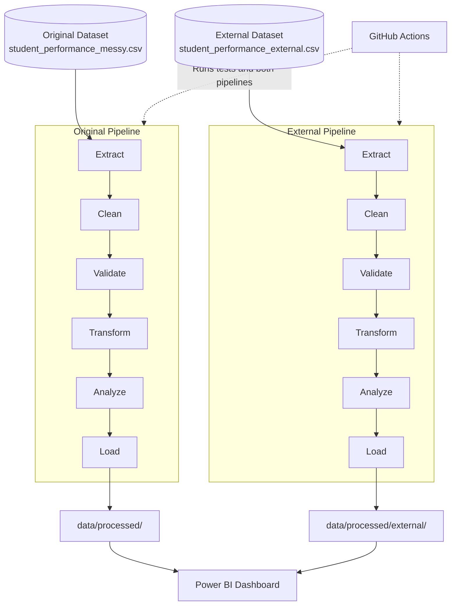
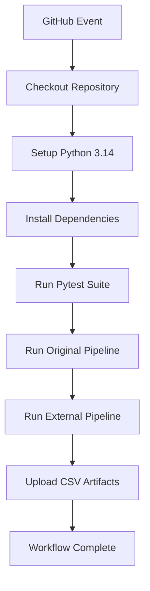

# Student Performance Analytics & Automated ETL Pipeline

[](https://github.com/vishal-kushwaha-9912/student-performance-analytics/actions/workflows/etl-pipeline.yml)


## Table of Contents

1. [Project Overview](#1-project-overview)
2. [Technology Stack](#2-technology-stack)
3. [Project Architecture](#3-project-architecture)
4. [Repository Structure](#4-repository-structure)
5. [Dataset Information](#5-dataset-information)
6. [Original ETL Pipeline](#6-original-etl-pipeline)
7. [External ETL Pipeline](#7-external-etl-pipeline)
8. [Centralized Pipeline Execution](#8-centralized-pipeline-execution)
9. [Analytical Results](#9-analytical-results)
10. [Automated Testing](#10-automated-testing)
11. [Continuous Integration with GitHub Actions](#11-continuous-integration-with-github-actions)
12. [Installation and Setup](#12-installation-and-setup)
13. [Running the Project](#13-running-the-project)
14. [Data Management and Git Configuration](#14-data-management-and-git-configuration)
15. [Current Project Status](#15-current-project-status)
16. [Future Improvements](#16-future-improvements)
17. [Learning Outcomes](#17-learning-outcomes)
18. [Conclusion](#18-conclusion)
19. [License](#19-license)
20. [Acknowledgements and Citation](#20-acknowledgements-and-citation)
21. [Author](#author)

---

## 1. Project Overview

**Student Performance Analytics & Automated ETL Pipeline** is a Python-based data engineering and analytics project that demonstrates how raw student data can be extracted, cleaned, validated, transformed, analyzed, and stored using an automated ETL workflow.

The project implements two independent ETL pipelines:

1. **Original Student Performance Pipeline:** Processes a small, deliberately messy student dataset to demonstrate fundamental data cleaning and analytics operations.
2. **External Student Performance Pipeline:** Processes a larger real-world student performance dataset from the UCI Machine Learning Repository, containing 395 records and 33 original columns.

Both pipelines follow a modular architecture, separating extraction, cleaning, validation, transformation, analysis, and loading into individual Python modules.

A centralized command-line interface allows users to select and execute either pipeline.

The project also includes automated tests using Pytest and continuous integration through GitHub Actions.

### Project Objectives

- Build reusable and modular ETL pipelines.
- Process both small and larger structured datasets.
- Implement data cleaning and validation techniques.
- Perform exploratory and descriptive data analysis.
- Generate meaningful student performance metrics.
- Store cleaned, transformed, and summarized datasets.
- Implement automated testing for pipeline reliability.
- Integrate automated testing and execution with GitHub Actions.
- Prepare processed datasets for visualization using Power BI.

---

## 2. Technology Stack

| Technology       | Purpose                             |
| ---------------- | ----------------------------------- |
| Python 3.14      | Core programming language           |
| Pandas           | Data manipulation and analysis      |
| Pytest           | Automated testing                   |
| CSV              | Raw and processed data storage      |
| Git              | Version control                     |
| GitHub           | Source code management              |
| GitHub Actions   | Continuous integration              |
| Power BI         | Data visualization and dashboarding |
| Jupyter Notebook | Data exploration                    |
| VS Code          | Development environment             |

---

## 3. Project Architecture

The project follows a modular architecture with two independent ETL pipelines. GitHub Actions is shown separately because it automates testing and pipeline execution; it does not build the Power BI dashboard.

### ETL Workflow



### ETL Components

| Component | Responsibility                                            |
| --------- | --------------------------------------------------------- |
| Extract   | Reads raw CSV datasets                                    |
| Clean     | Standardizes column names and cleans data                 |
| Validate  | Checks schema, data types, and valid ranges               |
| Transform | Creates calculated columns and performance categories     |
| Analyze   | Calculates descriptive statistics and performance metrics |
| Load      | Exports processed datasets and summaries                  |

Each component is maintained in a separate Python module to improve readability, maintainability, and testability.

---

## 4. Repository Structure

```text
student-performance-Analytics/
│
├── .github/
│   └── workflows/
│       └── etl-pipeline.yml
│
├── data/
│   ├── raw/
│   │   ├── student_performance_messy.csv
│   │   └── student_performance_external.csv
│   │
│   └── processed/
│       ├── [Original pipeline outputs]
│       │
│       └── external/
│           ├── student_performance_cleaned.csv
│           ├── student_performance_transformed.csv
│           └── performance_summary.csv
│
├── notebooks/
│   └── exploration.ipynb
│
├── powerbi/
│   └── Student_Performance_Analytics_Dashboard.pbix
│
├── reports/
│
├── dags/
│
├── src/
│   ├── extract.py
│   ├── clean.py
│   ├── validate.py
│   ├── transform.py
│   ├── analyze.py
│   ├── load.py
│   ├── pipeline.py
│   │
│   └── external/
│       ├── __init__.py
│       ├── extract.py
│       ├── clean.py
│       ├── validate.py
│       ├── transform.py
│       ├── analyze.py
│       ├── load.py
│       └── pipeline.py
│
├── tests/
│   ├── test_pipeline.py
│   └── test_external_pipeline.py
│
├── main.py
├── requirements.txt
├── .gitignore
├── LICENSE
└── README.md
```

**Note:** The original pipeline's processed outputs are stored directly under `data/processed/`. External pipeline outputs are stored separately in `data/processed/external/`.

---

## 5. Dataset Information

The project works with two different datasets.

### 5.1 Original Student Dataset

**File:** `data/raw/student_performance_messy.csv`

This dataset is designed to demonstrate data cleaning and preprocessing techniques using a small dataset.

**Dataset characteristics:**

- 10 student records.
- 6 original columns.
- Contains deliberately messy data that requires preprocessing.

| Column      | Description               |
| ----------- | ------------------------- |
| student_id  | Unique student identifier |
| name        | Student name              |
| study_hours | Student study hours       |
| attendance  | Student attendance        |
| sleep_hours | Student sleeping hours    |
| marks       | Student marks             |

The original pipeline handles cleaning, missing values, validation, transformations, and descriptive analysis.

### 5.2 External Student Performance Dataset

**File:** `data/raw/student_performance_external.csv`

The external dataset contains 395 student records and 33 original columns.

It provides additional information about students' demographics, family backgrounds, school activities, study habits, and academic performance.

**Original dataset schema:**

| Category                    | Columns                                                        |
| --------------------------- | -------------------------------------------------------------- |
| Student information         | school, sex, age, address                                      |
| Family information          | famsize, Pstatus, Medu, Fedu, Mjob, Fjob, guardian             |
| Academic background         | reason, traveltime, studytime, failures                        |
| Support and activities      | schoolsup, famsup, paid, activities, nursery, higher, internet |
| Personal and social factors | romantic, famrel, freetime, goout, Dalc, Walc, health          |
| Attendance-related          | absences                                                       |
| Academic grades             | G1, G2, G3                                                     |

**Important dataset interpretation:**

- `G1`: First-period grade.
- `G2`: Second-period grade.
- `G3`: Final-period grade.
- `studytime`: Ordinal study-time category (1–4), not actual study hours.
- `absences`: Number of school absences.
- The external dataset does not contain an `attendance` column.

### 5.3 External Dataset Source and Attribution

The external student dataset used in this project was obtained from the **UCI Machine Learning Repository**.

| Detail        | Value                           |
| ------------- | ------------------------------- |
| Dataset       | Student Performance             |
| Repository    | UCI Machine Learning Repository |
| Dataset ID    | 320                             |
| Subject used  | Mathematics                     |
| Original file | `student-mat.csv`               |
| Authors       | Paulo Cortez and Alice Silva    |
| Records       | 395 students                    |
| Attributes    | 33                              |
| Grade scale   | 0–20                            |

**Official dataset source:** <https://archive.ics.uci.edu/dataset/320/student+performance>

**Dataset DOI:** <https://doi.org/10.24432/C5TG7T>

The UCI Student Performance collection contains two subject-specific datasets:

| Original dataset  | Subject     | Records | Attributes |
| ----------------- | ----------- | ------: | ---------: |
| `student-mat.csv` | Mathematics |     395 |         33 |
| `student-por.csv` | Portuguese  |     649 |         33 |

This project uses the Mathematics dataset (`student-mat.csv`), which was incorporated into the project as:

`data/raw/student_performance_external.csv`

The dataset contains demographic, social, family, school-related, and academic information collected from students at two Portuguese secondary schools.

It was selected because it provides a larger and more realistic data source for demonstrating data cleaning, validation, transformation, descriptive analytics, and automated ETL processing.

**Original dataset publication:**

Cortez, P., & Silva, A. (2008). _Using data mining to predict secondary school student performance._ Proceedings of the 5th Annual Future Business Technology Conference.

**Dataset citation:**

Cortez, P. (2008). _Student Performance_ [Dataset]. UCI Machine Learning Repository. <https://doi.org/10.24432/C5TG7T>

**Attribution note:** The external dataset originates from the UCI Machine Learning Repository. The processing, additional analytical columns, pass/fail classifications, performance categories, and summary outputs in this project are implemented independently as part of this project. Please consult the UCI dataset page for its current licence and reuse conditions.

### 5.4 Dataset Usage in This Project

| Dataset                            | Origin                                               | Purpose                                                                     |
| ---------------------------------- | ---------------------------------------------------- | --------------------------------------------------------------------------- |
| `student_performance_messy.csv`    | Original project sample dataset                      | Demonstrating basic ETL operations using deliberately messy student records |
| `student_performance_external.csv` | UCI Machine Learning Repository, Mathematics dataset | Demonstrating ETL processing and analytics on a larger external dataset     |

The two datasets are processed through separate pipelines because they have different schemas and data characteristics.

---

## 6. Original ETL Pipeline

The original pipeline demonstrates the complete ETL process using the smaller messy student dataset.

### Extraction

Reads the original CSV file from `data/raw/student_performance_messy.csv`.

### Cleaning

- Cleaning inconsistent values.
- Removing unnecessary unit characters.
- Standardizing numeric values.
- Handling missing study-hour values.
- Preparing data for validation and analysis.

### Validation

- Required columns.
- Duplicate student IDs.
- Invalid marks.
- Negative study hours.
- Basic data quality requirements.

### Transformation

Creates additional analytical columns, including student performance categories and attendance groups.

### Analysis

Calculates student performance statistics and correlation information.

### Loading

Saves processed datasets and analytical outputs under `data/processed/`.

---

## 7. External ETL Pipeline

The external pipeline extends the project to handle a larger dataset with a different schema.

### 7.1 Extract

**Module:** `src/external/extract.py`

- Locates the project root dynamically.
- Checks whether the external CSV file exists.
- Reads the dataset using Pandas.
- Returns the extracted DataFrame.

Expected raw dataset dimensions: `395 rows × 33 columns`

### 7.2 Clean

**Module:** `src/external/clean.py`

- Creating a copy of the original DataFrame.
- Standardizing column names.
- Removing leading and trailing spaces from text columns.
- Checking missing values.
- Checking duplicate records.

The cleaning stage reports missing-value and duplicate-record information before returning the cleaned dataset.

### 7.3 Validate

**Module:** `src/external/validate.py`

Validation includes required column verification, numeric data type verification, grade range validation, student age validation, ordinal column range validation, and negative absence validation.

| Column     | Expected Range |
| ---------- | -------------: |
| age        |          15–22 |
| Medu       |            0–4 |
| Fedu       |            0–4 |
| traveltime |            1–4 |
| studytime  |            1–4 |
| failures   |            0–3 |
| famrel     |            1–5 |
| freetime   |            1–5 |
| goout      |            1–5 |
| Dalc       |            1–5 |
| Walc       |            1–5 |
| health     |            1–5 |
| G1         |           0–20 |
| G2         |           0–20 |
| G3         |           0–20 |
| absences   |   0 or greater |

These ranges reflect the assumptions used by this project for the selected dataset. They should be reviewed if the pipeline is reused with a different population or dataset.

### 7.4 Transform

**Module:** `src/external/transform.py`

The transformation stage creates three additional columns.

**1. Average Grade:** `average_grade = mean(G1, G2, G3)`, rounded to two decimal places.

**2. Pass/Fail Classification**

| Final Grade (G3) | Result |
| ---------------- | ------ |
| 10–20            | Pass   |
| 0–9              | Fail   |

The passing threshold of 10 is a project-defined analytical assumption.

**3. Performance Classification**

| Final Grade (G3) | Performance       |
| ---------------- | ----------------- |
| 0–9              | Needs Improvement |
| 10–12            | Average           |
| 13–15            | Good              |
| 16–20            | Excellent         |

These performance bands are project-defined categories, not official academic classifications.

After transformation, the dataset contains `395 rows × 36 columns`.

### 7.5 Analyze

**Module:** `src/external/analyze.py`

- Total number of students.
- Average final grade.
- Number of passed and failed students.
- Student performance category distribution.
- Average grade by performance category.
- Highest, lowest, and median final grade.
- Average final grade by school.

The module also creates a structured summary DataFrame containing the main analytical metrics.

### 7.6 Load

**Module:** `src/external/load.py`

Creates `data/processed/external/` if it does not exist and writes:

| Output File                         | Description                                |
| ----------------------------------- | ------------------------------------------ |
| student_performance_cleaned.csv     | Cleaned dataset                            |
| student_performance_transformed.csv | Dataset with calculated analytical columns |
| performance_summary.csv             | Summary of key performance metrics         |

---

## 8. Centralized Pipeline Execution

**File:** `main.py`

A centralized command-line interface allows users to execute either pipeline without manually importing or calling individual modules.

```text
====================================
   STUDENT PERFORMANCE ANALYTICS
====================================

1. Run Original ETL Pipeline
2. Run External ETL Pipeline
3. Exit

====================================
```

| Option | Action                             |
| ------ | ---------------------------------- |
| 1      | Executes the original ETL pipeline |
| 2      | Executes the external ETL pipeline |
| 3      | Exits the application              |

The menu continues to display after a pipeline finishes, so users can run another pipeline without restarting. Invalid selections are handled with an appropriate message.

---

## 9. Analytical Results

The external dataset was processed successfully during project development. The results below were observed from the current dataset and transformation rules.

| Metric              | Result |
| ------------------- | -----: |
| Total Students      |    395 |
| Average Final Grade |  10.42 |
| Passed Students     |    265 |
| Failed Students     |    130 |
| Highest Grade       |     20 |
| Lowest Grade        |      0 |
| Median Grade        |     11 |

### Performance Distribution

| Performance Category | Students |
| -------------------- | -------: |
| Needs Improvement    |      130 |
| Average              |      134 |
| Good                 |       91 |
| Excellent            |       40 |
| **Total**            |  **395** |

### Average Final Grade by School

| School | Average Final Grade |
| ------ | ------------------: |
| GP     |               10.49 |
| MS     |                9.85 |

These are descriptive statistics. They do not establish that any student characteristic or school caused a difference in academic performance.

---

## 10. Automated Testing

The project uses **Pytest** to verify individual ETL components and complete pipeline execution.

| Test File                         | Purpose                                   |
| --------------------------------- | ----------------------------------------- |
| `tests/test_pipeline.py`          | Tests the original ETL pipeline (9 tests) |
| `tests/test_external_pipeline.py` | Tests the external ETL pipeline (7 tests) |

**Original pipeline tests** cover extraction, cleaning, transformation, analysis, loading, validation, duplicate student ID validation, invalid marks validation, and negative study-hour validation.

**External pipeline tests** cover external extraction, cleaning, validation, transformation, analysis, loading, and complete external pipeline execution.

Run the complete test suite:

```bash
python -m pytest -v
```

**Latest verified local result:** 16 tests passed (9 original + 7 external).

---

## 11. Continuous Integration with GitHub Actions

The project includes an automated workflow: `.github/workflows/etl-pipeline.yml`

### Workflow Triggers

- Push to the `main` branch.
- Pull requests targeting the `main` branch.
- Manual execution through GitHub Actions.
- Scheduled daily execution using a cron expression.

### Automated Workflow



| Step                  | Responsibility                       |
| --------------------- | ------------------------------------ |
| Checkout              | Retrieves the repository             |
| Setup Python          | Configures Python 3.14               |
| Install dependencies  | Installs required packages           |
| Run automated tests   | Executes both test suites            |
| Run original pipeline | Executes the original ETL workflow   |
| Run external pipeline | Executes the external ETL workflow   |
| Upload artifacts      | Stores generated processed CSV files |

The artifact upload includes `data/processed/*.csv` and `data/processed/external/*.csv`, retained for 14 days.

The scheduled cron expression is `30 3 * * *`. GitHub Actions interprets this schedule in UTC.

---

## 12. Installation and Setup

### Prerequisites

- Python 3.14 or a compatible Python environment.
- Git.
- Visual Studio Code or another Python IDE.

### Step 1: Clone the Repository

```bash
git clone <YOUR_GITHUB_REPOSITORY_URL>
cd student-performance-Analytics
```

### Step 2: Create a Virtual Environment

```bash
python -m venv .venv
```

Activate it on Windows PowerShell:

```powershell
.venv\Scripts\Activate.ps1
```

On macOS / Linux:

```bash
source .venv/bin/activate
```

### Step 3: Install Dependencies

```bash
python -m pip install --upgrade pip
pip install -r requirements.txt
```

### Step 4: Verify the Installation

```bash
python --version
python -m pytest --version
```

---

## 13. Running the Project

### Method 1: Centralized Menu

```bash
python main.py
```

Select `1` for the original ETL pipeline, `2` for the external ETL pipeline, or `3` to exit.

### Method 2: Run Original Pipeline Directly

```bash
python -m src.pipeline
```

### Method 3: Run External Pipeline Directly

```bash
python -m src.external.pipeline
```

### Method 4: Run Automated Tests

```bash
python -m pytest -v
```

---

## 14. Data Management and Git Configuration

The project uses `.gitignore` to prevent unnecessary or sensitive files from being committed.

### Files and Directories Excluded

- Generated processed datasets.
- Local virtual environments.
- Python cache files.
- Pytest cache and coverage outputs.
- Temporary files.
- Local environment variables and credentials.
- Local editor configuration.
- Generated reports.

### Raw Dataset Handling

The required raw CSV datasets are explicitly included through `.gitignore` exceptions:

- `student_performance_messy.csv`
- `student_performance_external.csv`

The external dataset comes from the UCI Machine Learning Repository (see [Section 5.3](#53-external-dataset-source-and-attribution)). Only redistribute externally sourced datasets when their licence permits it, and include appropriate attribution.

Never commit API keys, passwords, private certificates, or actual credentials.

---

## 15. Current Project Status

| Component                      | Status               |
| ------------------------------ | -------------------- |
| Original ETL pipeline          | Implemented          |
| External ETL pipeline          | Implemented          |
| Data extraction                | Implemented          |
| Data cleaning                  | Implemented          |
| Data validation                | Implemented          |
| Data transformation            | Implemented          |
| Data analysis                  | Implemented          |
| CSV output generation          | Implemented          |
| Centralized execution menu     | Implemented          |
| Original pipeline tests        | 9 tests              |
| External pipeline tests        | 7 tests              |
| Full local test suite          | 16 tests passed      |
| Dataset source and attribution | Documented           |
| GitHub Actions workflow        | Configured           |
| Power BI dashboard             | Project file present |

The project has been locally verified for both pipeline execution and automated tests. GitHub Actions execution should be confirmed from the repository's Actions tab after the updated workflow is pushed.

---

## 16. Future Improvements

### Data Engineering

- Add stronger categorical value validation.
- Improve missing-value handling strategies.
- Introduce structured logging instead of relying only on print statements.
- Add configurable input and output paths.
- Add data quality reports.
- Improve error handling and pipeline recovery.

### Data Analytics

- Perform deeper exploratory data analysis.
- Investigate relationships between study habits and academic performance.
- Compare academic performance across demographic groups.
- Add statistical analysis and hypothesis testing.
- Build additional analytical KPIs.
- Add the UCI Portuguese dataset (`student-por.csv`) for subject comparison.

### Data Visualization

- Expand the Power BI dashboard.
- Add interactive performance filters.
- Create school-wise and grade-wise comparisons.
- Visualize performance distributions and trends.

### Automation and Deployment

- Introduce Apache Airflow for workflow orchestration.
- Add database storage using MySQL or PostgreSQL.
- Implement scheduled data ingestion.
- Add automated data quality checks.
- Improve CI/CD practices.

### Advanced Analytics

- Develop predictive models for student performance.
- Explore classification and regression techniques.
- Compare machine learning algorithms.
- Evaluate models using appropriate performance metrics.

---

## 17. Learning Outcomes

This project demonstrates practical experience with:

- Python programming.
- Pandas and structured data processing.
- ETL pipeline architecture.
- Data cleaning and preprocessing.
- Data validation and quality checks.
- Descriptive data analysis.
- Working with and attributing external open datasets.
- Modular software development.
- Automated testing using Pytest.
- Git and GitHub version control.
- Continuous integration with GitHub Actions.
- Preparing datasets for Power BI visualization.

It also shows how a small data processing project can grow into a modular application that handles multiple datasets and independent processing workflows.

---

## 18. Conclusion

The **Student Performance Analytics & Automated ETL Pipeline** project demonstrates an end-to-end approach to structured data processing using Python.

By combining two independent ETL pipelines, a centralized execution interface, automated testing, and GitHub Actions integration, the project is a practical example of maintainable and testable data processing software.

The architecture is designed to support future improvements in data engineering, business intelligence, and advanced analytics.

---

## 19. License

The source code in this repository is licensed under the **MIT License**. See the [LICENSE](LICENSE) file for details.

The MIT License applies to this project's code only. The external dataset remains subject to the terms stated by the UCI Machine Learning Repository.

---

## 20. Acknowledgements and Citation

- **Dataset:** Cortez, P. (2008). _Student Performance_ [Dataset]. UCI Machine Learning Repository. <https://doi.org/10.24432/C5TG7T>
- **Publication:** Cortez, P., & Silva, A. (2008). _Using data mining to predict secondary school student performance._ Proceedings of the 5th Annual Future Business Technology Conference.

---

## Author

**Vishal Kushwaha**

Computer Science Engineering Student
Interested in Data Analytics, Data Science, Python, SQL, and Machine Learning.

**Project:** Student Performance Analytics & Automated ETL Pipeline
